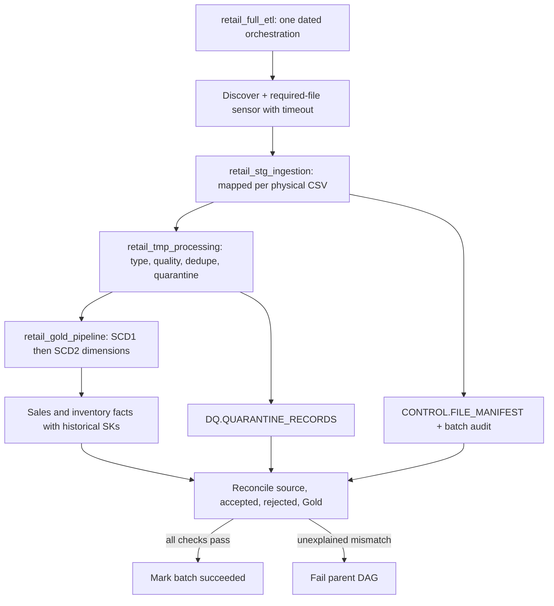
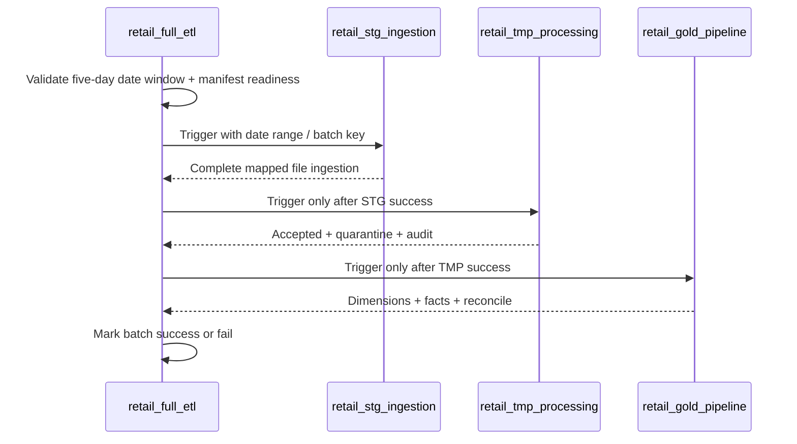

# Ycotek Assignment 2.3 — ETL Requirements, Reliability Improvements, and Verification Plan

**Purpose:** Implementation and test contract for a human developer or an agentic development tool.  
**Status:** Enhancement plan for an **already working** STG → TMP → TGT project; **not** permission to replace the working code or reset data.  
**Environment known from this project:** Apache Airflow **3.3.2** in Docker/WSL2; Snowflake database **`RETAIL_DWH`**; warehouse `SNOWFLAKE_LEARNING_WH`; Airflow Snowflake connection **`retail_snowflake`** and filesystem connection **`file_con`**.  
**Project root:** `/mnt/d/assignment2.3` on the developer's WSL machine, with source data mounted as `/opt/airflow/data` in Airflow.  
**Warehouse naming rule (from Ycotek):** **STG = Bronze**, **TMP = Silver**, **TGT = Gold**, **Aggregate = Gold roll-ups built from TGT**.  
**Source of truth:** The original Ycotek Assignment 2.3 slides, the user's selected 17-CSV fixture, the current repository files and the Gold ERD design. Follow the *actual checked-out code* if it differs from the historical generated examples; report the difference before editing.

> **Important interpretation of the requested improvement:** The goal is to replace the current **delete-and-reinsert TMP/DQ strategy** with **change-aware `MERGE` operations keyed by the stable `SOURCE_ROW_ID` for the *same source-file version***. **Never replace or regenerate `SOURCE_ROW_ID` in immutable STG just because a TMP row matches.** A corrected/reordered CSV creates a *new* file version and often new physical row IDs; that is a separate correction/replay workflow, not something `MERGE ON SOURCE_ROW_ID` solves by itself.

> **Implementation checkpoint (2026-11-19):** The user subsequently approved an expandable TaskGroup graph in `retail_full_etl`; preserve that approved design rather than reverting to child triggers. Conditional TMP/DQ MERGE and full-source configuration validation are now implemented, with local SQL regression tests. Real Snowflake fixture/replay verification is opt-in and has not yet run. See `evidence/silver_merge_checkpoint.md`. Descriptions below of the original delete/reinsert implementation are historical context, not the latest code. Date scoping, complete readiness, and audit controls remain pending.

---

## 1. Outcome / definition of done

Implement one controlled orchestration that, when launched for **five consecutive business dates**:

1. Waits (with timeout) for the required applicable CSVs.
2. Dynamically maps one STG ingest task per newly discovered physical file.
3. Preserves every original source row, even invalid business data; records its file version and row lineage.
4. Converts STG into typed, quality-checked TMP records; moves rejected rows into DQ with reason codes and auditable raw payloads.
5. Loads TGT dimensions (SCD1 + SCD2) **before** sales/inventory facts.
6. Resolves facts to the **dimension version valid at the sale/snapshot date**, not the current dimension by default.
7. Closes prior inventory position versions rather than deleting history.
8. Reconciles **raw = accepted + rejected** and **Gold = accepted** for both counts and appropriately defined amounts; fails the overall DAG if unexplained variance remains.
9. Succeeds on a **second run for the same dates and source bytes** with unchanged business records, financial totals, historical surrogate keys and effective intervals. Operational attempt logs may grow.
10. Produces tests, documentation and screenshots/log evidence that establish the results above.

**Do not** stop at "all DAG tasks green." A green DAG without the data assertions and repeatability tests is insufficient.

### Explicit slide-to-implementation mapping

| Ycotek slide requirement | Required implementation/test |
|---|---|
| File sensor waiting for all four source categories, timeout | Confirm 3 daily categories for each day **plus latest applicable weekly store snapshot**; fail on missing required file after bounded timeout |
| Dynamic mapping | One mapped STG ingest task per actual physical file; demonstrate 17 mapped children for fixture |
| Five consecutive days backfilled in one run | One entry-point/controller invocation with start/end date passed through all child DAGs; process historical dependencies in order |
| Idempotent every stage | Identical replay changes no final business row counts/amounts; improve TMP/DQ to avoid needless rewrites |
| `DIM_ITEM`, `DIM_LOCN` SCD2 with generated keys | Historical versions, valid-from/valid-to, no overlaps, exactly one current version, stable SKs on replay |
| At least one SCD1 attribute changed in place | Demonstrate `DIM_SUBCLASS` update using incremental dated data, preserving SK and row count |
| `FCT_INVENTORY` positional | Close old versions; never delete existing history on ordinary daily change |
| Day 3 defects | Keep invalid rows in STG; 5 distinct sales rows quarantined with correct reasons; run succeeds |
| Reconciliation fails DAG when Gold does not tie | Independent final SQL validation with explicit nonzero-variance failure |
| Deliverables | `dags/`, one SQL file per load under `include/sql/`, `tests/`, `README.md`, evidence; no DAG-embedded credentials/paths/table names |

### Scope boundary

The **Aggregate** Gold mapping is part of the Ycotek terminology, but the original Assignment 2.3 screenshots name six required TGT tables and **do not explicitly demand an aggregate mart**. Treat a daily-sales aggregate as optional unless a mentor requests it. The 17-CSV dataset and exact expected counts are a **development fixture**, not a production schema limitation or production reconciliation input.

---

## 2. Current codebase: preserve and audit before modifying

The user reports successfully running the separate STG, TMP, and Gold DAGs and then triggering them sequentially through the controller. **Do not recreate connections, schemas, tables, or raw sample files.** Confirm these facts with queries, not with assumptions based on past chat.

```text
assignment2.3/
├── dags/full_etl_pipeline/
│   ├── stg_ingestion.py               # retail_stg_ingestion
│   ├── retail_tmp_processing.py        # retail_tmp_processing
│   ├── retail_gold_pipeline.py         # retail_gold_pipeline (confirm present)
│   └── retail_full_etl.py              # controller retail_full_etl (confirm present)
├── config/
│   ├── retail_etl.json
│   ├── retail_tmp.json
│   └── retail_gold_config.json         # Airflow Variable must also exist, if DAG reads Variable
├── data/                               # 17 source CSVs; ignore/remove stale file_manifest.json
├── include/sql/
│   ├── bronze/
│   ├── control/01_file_manifest.sql
│   ├── ddl/
│   ├── silver/
│   ├── gold/
│   └── reconcile/
├── tests/fixtures/expected_results.json   # test-only oracle
└── README.md
```

In the user's latest folder tree, the SQL files were **renamed without numeric prefixes** (for example `validate_pos_sales.sql`, `prepare_dim_item.sql`, `merge_fct_sales.sql`, `reconcile_gold.sql`). Review each DAG's filename lookup and align with the actual disk files. Never assume the earlier `02_validate_...sql` names still exist.

The latest tree also showed **`data/file_manifest.json`**. This is a **stale distribution sidecar for the original 20-file sample**, not a source input or a production-control manifest. Keep it out of any CSV discovery, sensors and reconciliation; preferably move or delete it after confirming it is not needed. The live manifest belongs in **`RETAIL_DWH.CONTROL.FILE_MANIFEST`** and is computed by the pipeline.

### Currently existing objects

| Area | Existing logical objects |
|---|---|
| STG | `ITEM_MASTER`, `STORE_MASTER`, `POS_SALES`, `INVENTORY_SNAPSHOT` — immutable metadata + `RAW_PAYLOAD VARIANT` |
| TMP | Same four clean typed tables; existing `PROCESSED_AT` column |
| DQ | `QUARANTINE_RECORDS` with `REASON_CODE`, `REASON_DETAIL`, `RAW_PAYLOAD`, `REJECTED_AT` |
| TGT | `DIM_SUBCLASS`, `DIM_DISTRICT`, `DIM_ITEM`, `DIM_LOCN`, `FCT_SALES`, `FCT_INVENTORY` |
| CONTROL | `FILE_MANIFEST`; add batch/day audit, reconciliation result history and test-only baseline objects if necessary |

**Before making edits:** confirm the current SQL DDL using `DESCRIBE TABLE`, run `airflow dags list-import-errors`, inspect actual DAG IDs, and capture a baseline of counts, sums, lineage IDs, SCD2 periods and timestamps. Do not claim a production feature is implemented merely because this document describes it.

---

## 3. Input contract and fixture expectations

### Selected fixture (known, not a production invariant)

The chosen five-day window is **2026-11-09 through 2026-11-13**. Each CSV has **30 data rows**.

| File pattern | Arrival | Files | STG rows | Required TGT output |
|---|---|---:|---:|---|
| `item_master_YYYYMMDD.csv` | Daily snapshot | 5 | 150 | `DIM_ITEM`, `DIM_SUBCLASS` |
| `store_master_YYYYMMDD.csv` | Weekly/as-needed snapshot | **2** (Nov 9 and Nov 11) | 60 | `DIM_LOCN`, `DIM_DISTRICT` |
| `pos_sales_YYYYMMDD.csv` | Daily transactions | 5 | 150 | `FCT_SALES` |
| `inventory_snapshot_YYYYMMDD.csv` | Daily position | 5 | 150 | `FCT_INVENTORY` |
| **Total** | | **17** | **510** | **6 TGT tables** |

The store master for Nov 9 applies on Nov 9–10; the Nov 11 exceptional snapshot applies on Nov 11–13. **Do not require daily store files that do not exist.** Never apply a later snapshot backward to an earlier business date.

### CSV business fields

- Item: `snapshot_date,item_id,item_name,subclass_id,subclass_name,brand,unit_of_measure,list_price,is_active`
- Store: `snapshot_date,store_id,store_name,district_id,district_name,city,region,is_active`
- Sales: `sale_date,transaction_id,line_number,store_id,item_id,quantity,unit_price,discount_amount,net_sales,payment_method`
- Inventory: `snapshot_date,store_id,item_id,quantity_on_hand,unit_cost,inventory_value`

### Fixture acceptance oracle (test suite only)

| Test | Expected |
|---|---:|
| STG all four tables total | 510 |
| TMP accepted rows total | 505 |
| DQ rejected physical sales rows | 5 |
| TMP/TGT sales rows | 145 |
| TGT total net sales | **1566.15** |
| Excluded sales amount | **61.70** |
| Gold `DIM_SUBCLASS`, `DIM_DISTRICT` | 6 each |
| Gold `DIM_ITEM`, `DIM_LOCN` | 31 each |
| Gold `FCT_INVENTORY` | **98** (current change-compressed design) |

The 98 inventory rows are a **design-dependent test oracle**: they assume a new position version when quantity, unit cost, inventory value **or historical `ITEM_SK`/`LOCN_SK` changes**. There remain **150 valid daily inventory observations** in TMP. If the business chooses a different positional grain, document and retest it before changing the expected value.

**Day 3 sales defects:** two `NULL_ITEM_ID` rows (data rows 26–27), one `NEGATIVE_QUANTITY` (28), one `UNKNOWN_ITEM_ID` (29), and one `DUPLICATE_SALES_LINE` (30, duplicate of data row 15). Accept 25 of the 30 Day 3 raw sales rows. A valid `STORE007` district change on Nov 11 is **not** rejected; a valid `ITEM005` change on Nov 12 creates SCD2 history; `SC03` subclass name change on Nov 13 is an SCD1 event.

`tests/fixtures/expected_results.json` must be accessible **to test code only**, not the runtime DAG. In production, calculate row counts and net amounts from actual STG, TMP, DQ and TGT records. If the fixture is temporarily unavailable, the DAG must still operate normally.

---

## 4. Architecture and responsibility boundaries



**Keep modules separated:** existing Python DAGs and SQL files remain independent. The subsequently approved controller uses expandable TaskGroups with real tasks; standalone layer DAGs remain available. Carry window/batch context consistently through those groups rather than requiring child-run `conf`. Temporary work tables for `prepare_*` + `merge_*` must run in the **same Snowflake session** where applicable.

**DDL versus DML:** `include/sql/ddl/*` creates structures in a controlled migration; the ETL DAG executes repeatable loading SQL. Do **not** run `CREATE OR REPLACE` on populated production/STG/TGT tables; ordinary Snowflake DDL should not occur inside a transaction intended to atomically `MERGE` TMP/DQ because DDL causes implicit commits. See Snowflake Transactions reference.

---

## 5. Identities: don't confuse a physical source row with a business event

| Field | Origin | Stable on identical file replay? | Stable if same-name file is reordered/corrected? |
|---|---|---|---|
| `SOURCE_FILE_SHA256` | SHA-256 of CSV bytes | Yes | **No** |
| `SOURCE_FILE_ID` | SHA-256(`filename + ':' + file SHA`) | Yes | **No** |
| `SOURCE_ROW_ID` | SHA-256(`SOURCE_FILE_ID + ':' + data-row number`) | Yes | **No** |
| `SOURCE_ROW_NUMBER` | Physical row position in that file | Yes | No for reordered rows |
| `TRANSACTION_ID`, `LINE_NUMBER` | Business source CSV | Yes | Normally yes, assuming source keys stable |
| `ITEM_ID`, `STORE_ID` | Business source CSV | Yes | Normally yes |
| `ITEM_SK`, `LOCN_SK` | Warehouse-generated SCD surrogate keys | Yes if version unchanged | Retain when same historical version is unchanged |
| `BATCH_ID` | Current STG code uses Airflow `run_id` | Within a single ingest attempt | May differ across reruns |

### Immutable-source rule

1. **Keep `SOURCE_ROW_ID` unchanged for a given physical file version**. It is lineage, not a value that should be "replaced" during TMP merge.
2. For the same `SOURCE_ROW_ID`, if transformed business values and validation decision are unchanged, **do nothing**. Keep `PROCESSED_AT`/`REJECTED_AT` unchanged.
3. For the same `SOURCE_ROW_ID`, if a **versioned validation rule** or approved transformation changes the classification/content, update the appropriate current TMP/DQ result *transactionally*; do not overwrite STG.
4. If a same-name source file has a **different SHA-256**, the current STG implementation **raises an error intentionally**. A `MERGE ON SOURCE_ROW_ID` will **not** resolve it because new file version IDs imply new source-row IDs. Use the **separate correction workflow** described in §8.
5. Sales uniqueness is based on the **business transaction-line key**, currently `(TRANSACTION_ID, LINE_NUMBER)` according to the validation SQL. Confirm that transaction IDs are globally unique; if scoped by store, use `(STORE_ID, TRANSACTION_ID, LINE_NUMBER)` consistently in TMP, DQ, TGT and reconciliation. **Never deduplicate sales solely on `SOURCE_ROW_ID`.**

---

## 6. First improvement to implement: replace TMP/DQ delete-and-reinsert with change-aware MERGE

### 6.1 What the current code really does

In `retail_tmp_processing.py`, `process_source()` runs one validation SQL per source and creates a session-local decision table (`TMP.WORK_*`). It then executes the following pattern inside a transaction:

1. `DELETE FROM TMP.<source> WHERE SOURCE_ROW_ID IN (SELECT SOURCE_ROW_ID FROM STG.<source>)`.
2. `DELETE FROM DQ.QUARANTINE_RECORDS WHERE SOURCE_TYPE = ... AND SOURCE_ROW_ID IN (...)`.
3. `INSERT` all accepted rows from `WORK_*` into TMP.
4. `INSERT` all rejected rows from `WORK_*` into DQ.

That gives **logical idempotency** on unchanged input (same rows/totals) but replaces rows needlessly. Thus `PROCESSED_AT` and `REJECTED_AT` usually refresh on the second execution. It is also a whole-available-source rewrite rather than processing only affected dates/files.

### 6.2 Target behavior

For **each physical source row in the selected processing scope**, build a deterministic `WORK_*` classification with:

- immutable `SOURCE_ROW_ID`, `SOURCE_FILE_ID`, `SOURCE_ROW_NUMBER`, source date and original `BATCH_ID`;
- all typed business fields for accepted rows;
- `REJECT_REASON` (one primary reason, or a separate multi-reason table if expanded);
- a **business-content fingerprint** that excludes `PROCESSED_AT`, `REJECTED_AT`, DAG run time and other volatile metadata;
- an optional `VALIDATION_RULESET_VERSION` to distinguish changed rules.

Maintain **exactly one live disposition** for each in-scope `SOURCE_ROW_ID`:

| Prior disposition | New decision | Required action |
|---|---|---|
| Absent | Accepted | Insert into TMP |
| Absent | Rejected | Insert into DQ |
| Accepted | Accepted, same values | **No-op**; preserve `PROCESSED_AT` |
| Accepted | Accepted, changed derived values | `MERGE WHEN MATCHED AND changed` → update non-key fields and `PROCESSED_AT` |
| Rejected | Rejected, same reason/payload | **No-op**; preserve `REJECTED_AT` |
| Rejected | Rejected, changed reason/details | `MERGE WHEN MATCHED AND changed` → update reason/detail and timestamp |
| Rejected | Accepted | Remove/mark inactive the *current* DQ disposition, then `MERGE` TMP |
| Accepted | Rejected | Remove/mark inactive the *current* TMP disposition, then `MERGE` DQ |

**No blanket delete+insert on identical reruns.** A narrowly scoped removal **is** legitimate when the current classification flips (otherwise the same source row would appear in both TMP and DQ). If preserving every decision over time is required, implement an append-only `DQ.DECISION_HISTORY` or an active-status flag; do not mistake current classification tables for immutable audit history.

### 6.3 Proposed implementation steps

1. **Back up the current state (test-only snapshots) and write red tests.** Run all changes in a dedicated test database/schema first; preserve existing successful records.
2. Keep four independent validation SQL files. **Do not modify Day 3 acceptance rules** while refactoring replay behavior.
3. Keep the temporary `WORK_*` creation **before** starting the explicit multi-statement transaction.
4. Assert the work set is unique on `SOURCE_ROW_ID`, has the same number of rows as the scoped STG input, and each row has exactly one accepted/rejected outcome.
5. Inside **one explicit transaction per source/day scope**:
   - Resolve accepted→rejected and rejected→accepted transitions with targeted deletes or status flips based only on work-row IDs.
   - `MERGE` the **accepted** `WORK_*` rows into the corresponding TMP table on `SOURCE_ROW_ID`.
   - `MERGE` the **rejected** `WORK_*` rows into the DQ table on `(SOURCE_TYPE, SOURCE_ROW_ID)`; if supporting multiple reasons per row, adjust the key or use a child reasons table.
   - Update transaction-scoped audit counts; run consistency queries; commit **only if** counts and exclusivity checks pass. Otherwise rollback.
6. For `WHEN MATCHED`, compare the typed business values and any deliberately tracked transformation version **null-safely** using `IS DISTINCT FROM`. **Do not include processing timestamps or Airflow attempt IDs in the changed-value predicate.**
7. `WHEN NOT MATCHED` inserts the source lineage and typed fields, using timestamp defaults only on first insert.
8. In a test run, execute the same TMP DAG twice. Assert matching business rows, **identical `PROCESSED_AT` and `REJECTED_AT` for unchanged rows**, no additional DQ rows and no new duplicates.
9. Add a **rule-change test**: deliberately alter a controlled fixture's accepted/rejected decision or derived output, verify the appropriate transition/update, and confirm old STG payload is not mutated.
10. Use a per-source/day lock or controlled DAG concurrency. A Snowflake merge is not a substitute for concurrency design if multiple runs can publish the same scope simultaneously.

### 6.4 Illustrative MERGE pattern (template, not drop-in SQL)

```sql
-- Assume WORK_POS_SALES was created and validated beforehand.
-- Keep each SOURCE_ROW_ID unique in the source subquery.
MERGE INTO RETAIL_DWH.TMP.POS_SALES AS t
USING (
    SELECT SOURCE_ROW_ID, SOURCE_FILE_ID, SOURCE_FILE_NAME,
           SOURCE_FILE_DATE, SOURCE_ROW_NUMBER, BATCH_ID,
           SALE_DATE, TRANSACTION_ID, LINE_NUMBER, STORE_ID, ITEM_ID,
           QUANTITY, UNIT_PRICE, DISCOUNT_AMOUNT, NET_SALES, PAYMENT_METHOD
    FROM RETAIL_DWH.TMP.WORK_POS_SALES
    WHERE REJECT_REASON IS NULL
) AS s
ON t.SOURCE_ROW_ID = s.SOURCE_ROW_ID
WHEN MATCHED AND (
    t.QUANTITY IS DISTINCT FROM s.QUANTITY OR
    t.NET_SALES IS DISTINCT FROM s.NET_SALES OR
    t.PAYMENT_METHOD IS DISTINCT FROM s.PAYMENT_METHOD
    -- Compare ALL other business fields and deliberately tracked lineage/ruleset fields.
) THEN UPDATE SET
    t.QUANTITY = s.QUANTITY,
    t.NET_SALES = s.NET_SALES,
    t.PAYMENT_METHOD = s.PAYMENT_METHOD,
    t.PROCESSED_AT = CURRENT_TIMESTAMP()
WHEN NOT MATCHED THEN INSERT (
    SOURCE_ROW_ID, SOURCE_FILE_ID, SOURCE_FILE_NAME, SOURCE_FILE_DATE,
    SOURCE_ROW_NUMBER, BATCH_ID, SALE_DATE, TRANSACTION_ID,
    LINE_NUMBER, STORE_ID, ITEM_ID, QUANTITY, UNIT_PRICE,
    DISCOUNT_AMOUNT, NET_SALES, PAYMENT_METHOD
) VALUES (
    s.SOURCE_ROW_ID, s.SOURCE_FILE_ID, s.SOURCE_FILE_NAME, s.SOURCE_FILE_DATE,
    s.SOURCE_ROW_NUMBER, s.BATCH_ID, s.SALE_DATE, s.TRANSACTION_ID,
    s.LINE_NUMBER, s.STORE_ID, s.ITEM_ID, s.QUANTITY, s.UNIT_PRICE,
    s.DISCOUNT_AMOUNT, s.NET_SALES, s.PAYMENT_METHOD
);
```

**Warning:** The example intentionally abbreviates the `WHEN MATCHED` comparison and update lists for readability. A developer/agent must generate complete, schema-accurate mappings for **all four TMP tables and the DQ table**. Do not copy this example unchanged and claim the upgrade is complete. The `MERGE` key is a physical row identity for the *same file version*, not the business-key correction rule.

### 6.5 Safety and correctness tests for the MERGE refactor

- Same source, same rules and same values, two runs: **zero updated rows**, unchanged `PROCESSED_AT` and `REJECTED_AT`.
- New source row: **one new accepted or rejected row**.
- Reprocessed source row with changed *derived* value: **one update**, same `SOURCE_ROW_ID`, no duplicate.
- Reclassification accepted→rejected: one TMP record removed/inactivated, one DQ record current, no duplicated disposition.
- Reclassification rejected→accepted: reverse transition, correct reason-history retention if implemented.
- A row with two defects is counted as **one rejected source row**, even if multiple reasons are recorded.
- Atomicity: simulated failure after a targeted disposition change but before both merges → transaction rollback, prior state fully restored.
- Independent test that a staged work set with duplicate `SOURCE_ROW_ID` is rejected **before** `MERGE` (Snowflake `MERGE` is not a uniqueness guarantee).

---

## 7. Data-quality and schema-evolution contract

**STG:** Never silently reject a business-invalid record. Preserve all raw field names and text values in `RAW_PAYLOAD VARIANT`, plus filename, date, immutable file/row IDs and ingestion metadata. If parsing the CSV itself is structurally impossible (wrong number of fields, duplicate headers, corrupt quotes), fail with a recorded file-level error and retain the original file for investigation; this is different from quarantining a parseable business-invalid row.

**TMP:** Use `TRY_TO_*` casts, deterministic typed fields and explicit validation priority. A new optional source column remains in STG but need not be added to TMP/TGT automatically. Missing **required** fields cause a documented row rejection or file-level failure depending on the contract; missing optional fields become `NULL`/approved defaults. Never auto-alter TGT simply because STG sees an extra column.

**DQ:** Quarantine the parseable invalid row with its raw payload, source-row identity and primary `REASON_CODE`, plus specific `REASON_DETAIL` where possible. Existing fixture codes include `NULL_ITEM_ID`, `NEGATIVE_QUANTITY`, `UNKNOWN_ITEM_ID`, `DUPLICATE_SALES_LINE`. A valid store district change is never a quarantine reason. Tests must check exact counts, reasons and source-row lineage.

**Business keys:** Deduplicate sales using the agreed transaction-line key; item/store master versioning uses item/store business ID and effective source date; inventory's daily logical key is `(STORE_ID, ITEM_ID, SNAPSHOT_DATE)`.

**Finance:** Keep amount fields as fixed-point `NUMBER(...,2)` rather than floating point. A malformed source amount cannot be reconciled by pretending it is zero—log a parse failure and mark the financial bridge failed or explicitly unreconciled.

---

## 8. Corrected/reordered files: separate from the TMP MERGE improvement

**Current behavior:** `stg_ingestion.py` computes `SOURCE_FILE_SHA256`, `SOURCE_FILE_ID = sha256(filename + ':' + file_hash)`, and `SOURCE_ROW_ID = sha256(file_id + ':' + row_number)`. Its manifest currently has at most one record per filename and **rejects** same-name files with a different hash. That is a safe initial limitation.

### Why `MERGE ON SOURCE_ROW_ID` is insufficient

A re-ordered or corrected same-name CSV produces a new `SOURCE_FILE_ID`, and therefore **new `SOURCE_ROW_ID`s for most or all rows**, even if business transactions are unchanged. A naive append or physical-row MERGE would treat these as new rows. It does not know that transaction `TX101 / line 1` is the same business event as before.

### Two supported policies (make the choice explicit)

**Policy A — safe bounded assignment scope (minimum):** Continue to reject changed same-name files with an informative error, keep the authoritative file version unchanged, and document **corrected-file replay is unsupported**. This still satisfies the core assignment's identical-file idempotency requirement and is safer than silent duplication.

**Policy B — production-style versioned corrections (recommended improvement after basic replay):**

1. Extend manifest to support **multiple versions of a logical filename** (unique `SOURCE_FILE_ID`; business/file logical identity + `FILE_VERSION`, `IS_ACTIVE`, `SUPERSEDES_FILE_ID`, `CORRECTION_REASON`, content SHA and timestamps).
2. Archive/preserve original files and immutable STG rows; ingest new bytes as a new source version instead of updating old `SOURCE_ROW_ID`s.
3. Decide which file version is **authoritative** for the affected date; never have two active versions of the same logical file at the same time.
4. Recompute the **effective** TMP/DQ dataset from active source versions for the affected date/business keys; publish it as one consistent replacement/merge transaction (including handling records removed from a corrected full file).
5. Compare by **business keys** to identify unchanged transactions, real corrections, deletions and additions. Historical surrogate keys in SCD2 and related facts must remain stable for truly unchanged versions.
6. Rebuild affected fact and dimension time ranges **chronologically**; a backdated correction may split, shorten or eliminate historical periods. The original versions remain auditable.
7. Reconcile both count and signed amount adjustments, promote the new version atomically, and rollback or mark the correction failed if any validation cannot be reconciled.
8. Repeat the identical corrected version; expect zero further business-state changes.

**Important:** A corrected *full snapshot* may legitimately remove rows. `MERGE` alone does not automatically remove obsolete active rows. Define explicit source-version scoping and targeted `DELETE`/inactivation in the **active derived view** while preserving original raw history.

### Correction test matrix

| Scenario | Required outcome |
|---|---|
| Same filename, same bytes | Skip; same file IDs and row IDs |
| Same filename, same business rows reordered | New SHA/file version; if Policy B enabled, no duplicated Gold business transactions |
| Same filename, one quantity corrected | Exactly one authoritative business-line correction, not an extra Gold line |
| Corrected file removes a transaction | Obsolete active line removed from TGT/current view; preserved in source audit |
| Corrected file adds transaction | Exactly one new Gold line |
| Corrected historical master snapshot | SCD2 validity recomputed chronologically, no period overlaps, facts re-keyed if required |
| Correction rejected halfway | Previous active version still authoritative; no partial publication |

Do not enable Policy B by quietly weakening Policy A's checksum rejection. Implement it as an explicit separately tested feature.

---

## 9. Five-day backfill, sensors, task mapping and control tables

### Current limitations (implement before final submission)

- `retail_full_etl` now runs three expandable TaskGroups in sequence, but the current STG tasks use `file_limit=0` = **all recognized files on disk**, not a selected start/end date. Remaining references to child triggers below describe the original design; adapt their window/failure requirements to the approved TaskGroup design.
- TMP and Gold currently read **all** STG/TMP records, not an explicitly passed five-day processing scope.
- The basic STG DAG discovers files but does **not** yet implement the assignment's complete sensor/timeout contract for all required applicable sources.
- The current `BATCH_ID` derives from an Airflow `run_id` for original STG ingestion. This is execution lineage, **not a stable logical batch identity across retries/replays**.

### Required changes

1. Add explicit controller parameters `start_date`, `end_date` (inclusive five dates, validated in YYYY-MM-DD format) and optional `batch_key`/`correction_mode` as controlled inputs.
2. Controller passes the same logical window/batch identity through STG, TMP and Gold child DAG `conf` and waits for each child's **success** before starting the next. Child run IDs may be execution-specific but `BATCH_ID` for the logical processing window must be stable.
3. Introduce `CONTROL.ETL_BATCH`, `CONTROL.ETL_BATCH_DAY`, and/or per-stage audit rows storing logical batch, run attempts, date, status, source counts, accepted/rejected counts and result timestamps; retain an audit trail rather than overwriting every attempt.
4. For each date, require **three daily physical files** and resolve the latest applicable store master snapshot with `store_snapshot_date <= date`. Await inputs with a **bounded sensor timeout**; give a clear missing-file list. In the chosen fixture, 17 physical files are expected across the five-date window.
5. Map ingestion over actual physical files; no fake store file per day. Ensure deterministic selection of the authoritative file version; no accidental ingestion of `README.md`, JSON sidecars or unsupported names.
6. Apply historical master changes in increasing effective-date order. Do not allow Day 5 history to be processed ahead of Day 3 in a way that changes SCD2 keys or validity incorrectly.
7. Ensure TMP and Gold do not read unrelated dates/files; their published scope and reconciliation must match `start_date`/`end_date`.
8. Set and verify safe retries, child DAG wait behavior, no overlapping runs that publish the same date range, and distinct statuses for **timeout**, **quality quarantine**, **reconciliation failure**, and **infrastructure failure**.
9. A parent DAG must fail if a child DAG fails or if final reconciliation fails; never mark a batch `SUCCESS` before all checks complete.
10. Capture evidence of *one invocation* processing five business dates. Airflow's built-in backfill of multiple DAG runs is a different mechanism; don't claim that as one DAG run without explaining the difference.



---

## 10. TGT historical rules and reconciliation

### Six required TGT tables and grain

| Table | Grain | Load behavior |
|---|---|---|
| `TGT.DIM_SUBCLASS` | One current row per subclass business key | SCD1 in-place name update; preserve `SUBCLASS_SK` |
| `TGT.DIM_DISTRICT` | One current row per district business key | SCD1 in-place update; preserve `DISTRICT_SK` |
| `TGT.DIM_ITEM` | One row per `(ITEM_ID, EFFECTIVE_FROM)` version | SCD2; preserve `ITEM_SK` when identical, close prior version on real tracked change |
| `TGT.DIM_LOCN` | One row per `(STORE_ID, EFFECTIVE_FROM)` version | SCD2; district ID change on Nov 11 creates a new store version |
| `TGT.FCT_SALES` | One accepted unique sales line | `ITEM_SK` and `LOCN_SK` chosen by `SALE_DATE`; no quarantined rows |
| `TGT.FCT_INVENTORY` | One item/store positional version | Half-open effective dates, one open version per item/store, prior versions closed not deleted |

**Effective-date convention:** `[EFFECTIVE_FROM, EFFECTIVE_TO)` (inclusive start, exclusive end); `EFFECTIVE_TO IS NULL` for current. No overlap and exactly one current version per relevant business key. Never join facts only on `IS_CURRENT=TRUE`.

**SCD1 demonstration must be incremental:** A one-shot five-day load into initially empty SCD1 tables usually creates only the *latest* description; it does not prove an update occurred. In an isolated test, first run through Nov 12, capture `SC03`'s `SUBCLASS_SK` and description, then apply Nov 13 and verify the description changes **in place** while the SK and subclass row count remain unchanged.

**TGT current implementation:** Gold already uses SCD prepare/merge scripts and basic reconciliation. Preserve these unless a test reveals an issue. A historical rewrite/correction requires additional logic beyond the ordinary identical-replay `MERGE`.

### Reconciliation contract

Per business date (and rolled up over the five-day window):

```text
Raw sales row count = accepted sales row count + unique rejected sales row count
Gold sales row count = accepted sales row count
Raw parseable signed sales amount = accepted amount + excluded/rejected amount
Gold net sales = accepted amount
```

Any unparseable source monetary value needs an explicit failure/exception accounting rule; it must not disappear via `COALESCE(...,0)` and falsely pass. The existing `reconcile_gold.sql` already checks for unparseable raw and quarantined amounts, and the Gold DAG should raise if any daily result reports `FAIL`.

**Fixture daily values:**

| Date | Raw sales | Accepted | Quarantined | Raw net | Gold net | Excluded net |
|---|---:|---:|---:|---:|---:|---:|
| 2026-11-09 | 30 | 30 | 0 | 303.90 | 303.90 | 0.00 |
| 2026-11-10 | 30 | 30 | 0 | 321.00 | 321.00 | 0.00 |
| 2026-11-11 | 30 | 25 | 5 | 343.20 | 281.50 | 61.70 |
| 2026-11-12 | 30 | 30 | 0 | 332.20 | 332.20 | 0.00 |
| 2026-11-13 | 30 | 30 | 0 | 327.55 | 327.55 | 0.00 |
| **Total** | **150** | **145** | **5** | **1627.85** | **1566.15** | **61.70** |

**Never** read these hard-coded expectations from fixture JSON inside production DAGs. Production reconciliation compares warehouse datasets directly and writes durable `CONTROL.RECON_RESULTS` keyed by batch/date/rule; allow attempt audit history separately.

---

## 11. Test catalog: what to build, how to run it, how to verify it

**Test philosophy:** Tests must fail when a constraint is violated. A query that merely returns rows for a human to inspect is diagnostic, not a complete automated test. Use assertions in pytest or an Airflow task that raises on unexpected results. Run destructive failure injection only in **disposable test schemas or cloned test databases**, not in the user's working `RETAIL_DWH` tables.

### A. Source readiness, ingestion, backfill

| ID | Test case / setup | Verification / expected result |
|---|---|---|
| A01 | Input has 17 selected fixture CSVs | Discovery finds exactly 17 valid physical inputs, not README/JSON |
| A02 | Missing `pos_sales_20261112.csv` in isolated test landing | Readiness sensor times out and reports missing file; TMP/TGT not triggered |
| A03 | Nov 10 has no store file | Applicable Nov 9 store snapshot selected; does not time out |
| A04 | Nov 12/13 have no store file | Nov 11 store snapshot selected; no invented daily store file |
| A05 | One file arrives late but before timeout | Sensor unblocks, exactly one mapped ingest task runs |
| A06 | One dated controller call Nov 9–13 | Exactly those five business dates, 17 source files, 17 mapped physical ingests |
| A07 | Trigger identical STG run twice | STG stays at 510 rows, manifest has 17 active selected file versions |
| A08 | Malformed CSV syntax / unmatched row width | File-level error; raw source preserved, no partial STG commit |
| A09 | CSV with unexpected optional field | STG `RAW_PAYLOAD` preserves it; TMP/TGT schema unchanged unless mapping is approved |
| A10 | Missing mandatory field | Tracked quality rejection/file failure; no silent data loss |

### B. TMP and DQ

| ID | Test case / setup | Verification / expected result |
|---|---|---|
| B01 | Normal fixture | TMP `ITEM_MASTER=150`, `STORE_MASTER=60`, `POS_SALES=145`, `INVENTORY_SNAPSHOT=150` |
| B02 | Day 3 fixture | DQ exactly 5 physical sales rows, reasons `NULL_ITEM_ID=2`, other three=1 |
| B03 | Duplicate transaction line | Exactly one accepted canonical business line, duplicate quarantined |
| B04 | Other invalid quantity/item | Invalid records retained in STG, absent from TMP and TGT |
| B05 | TMP identical rerun after MERGE upgrade | Same 505 accepted + 5 DQ, same typed values and unchanged timestamps |
| B06 | Work table contains duplicated `SOURCE_ROW_ID` | Preflight blocks MERGE, no partial target writes |
| B07 | Same physical row's transformation changes | Conditional MERGE updates only that row, retains same immutable `SOURCE_ROW_ID` |
| B08 | Accepted→rejected and rejected→accepted controlled test | Exactly one current disposition, old decision audited if history enabled |
| B09 | In-transaction fault after first TMP/DQ change | Rollback leaves both datasets at their previous state |
| B10 | Two defects in one physical row | Count row once in rejection/financial bridge; preserve multiple reasons separately if supported |
| B11 | Run with `tests/fixtures/expected_results.json` inaccessible to DAG | Production TMP and reconciliation still run; tests can still use fixture externally |

### C. Gold dimensions and facts

| ID | Test case / setup | Verification / expected result |
|---|---|---|
| C01 | Full fixture Gold load | `DIM_SUBCLASS=6`, `DIM_DISTRICT=6`, `DIM_ITEM=31`, `DIM_LOCN=31` |
| C02 | Store district change on Nov 11 | `STORE007` two SCD2 versions (`DIST01` then `DIST03`), prior row closed |
| C03 | Item change on Nov 12 | `ITEM005` two SCD2 versions, earlier attributes retained |
| C04 | SCD1 incremental Nov 12→13 | `SC03` renamed in place; `SUBCLASS_SK` unchanged |
| C05 | Sales fact | 145 accepted lines, sum `NET_SALES=1566.15` |
| C06 | Historical sale before/after SCD2 change | References correct `ITEM_SK` and `LOCN_SK` effective on sale date |
| C07 | Inventory observations | 150 TMP observations account for 98 positional versions under chosen state-change rule |
| C08 | Daily position changes | Earlier `FCT_INVENTORY` versions closed, none deleted, one open per key |
| C09 | Re-run Gold without source changes | Identical SKs, row counts, effective intervals and sales totals |
| C10 | Inject overlapping SCD2 intervals | Integrity query yields failures; reconciliation task fails DAG |
| C11 | Missing/multiple dimension version for a fact | Fact task must fail (no silent `CURRENT` fallback) |

### D. Reconciliation, failure recovery, version corrections

| ID | Test case / setup | Verification / expected result |
|---|---|---|
| D01 | Normal fixture | Every day's raw/accepted/rejected/Gold count and financial bridge `PASS` |
| D02 | Alter one fact net amount in isolated test copy | Reconciliation `FAIL` and controller run fails |
| D03 | Force a downstream task failure | Controller does not declare success; batch audit status accurate |
| D04 | Re-run same five-day window | No business-state difference; operational attempt audit may grow |
| D05 | Same-name source file changed, Policy A | Clear rejection; existing authoritative results unchanged |
| D06 | Same-name reordered source file, Policy B only | New raw file version, no duplicate Gold business events |
| D07 | Corrected source quantity, Policy B only | Single corrected authoritative transaction, history/audit retained |
| D08 | Backdated dimension correction, Policy B only | Recomputed valid intervals and fact keys, no overlaps or duplicate SKs |
| D09 | Unexpected schema expansion | Raw field retained; controlled typed mapping, no unintended TGT DDL |
| D10 | Simulated upload or warehouse outage | Retries within policy; eventual success idempotent or failure explicit |

### Required test implementation locations

```text
tests/
├── fixtures/
│   ├── expected_results.json         # existing; testing only
│   └── edge_cases/                   # new small, isolated CSV fixtures
├── unit/
│   ├── test_file_contract.py
│   ├── test_source_ids.py
│   ├── test_business_keys.py
│   └── test_dag_structure.py
├── integration/
│   ├── test_stg_ingest.py
│   ├── test_tmp_merge_and_dq.py
│   ├── test_gold_history.py
│   └── test_reconciliation.py
└── e2e/
    └── test_five_day_replay.py
include/sql/reconcile/
├── reconcile_gold.sql
├── check_gold_integrity.sql
└── verify_tmp.sql
```

### Minimum useful manual Snowflake queries

**Check all six Gold table counts:**

```sql
SELECT 'DIM_SUBCLASS' AS TABLE_NAME, COUNT(*) AS N FROM RETAIL_DWH.TGT.DIM_SUBCLASS
UNION ALL SELECT 'DIM_DISTRICT', COUNT(*) FROM RETAIL_DWH.TGT.DIM_DISTRICT
UNION ALL SELECT 'DIM_ITEM', COUNT(*) FROM RETAIL_DWH.TGT.DIM_ITEM
UNION ALL SELECT 'DIM_LOCN', COUNT(*) FROM RETAIL_DWH.TGT.DIM_LOCN
UNION ALL SELECT 'FCT_SALES', COUNT(*) FROM RETAIL_DWH.TGT.FCT_SALES
UNION ALL SELECT 'FCT_INVENTORY', COUNT(*) FROM RETAIL_DWH.TGT.FCT_INVENTORY;
```

**Check quarantine reason counts:**

```sql
SELECT REASON_CODE, COUNT(*) AS REJECTED
FROM RETAIL_DWH.DQ.QUARANTINE_RECORDS
WHERE SOURCE_TYPE = 'pos_sales'
GROUP BY REASON_CODE ORDER BY REASON_CODE;
```

**Check no accepted/quarantined overlap (should return zero):**

```sql
SELECT COUNT(*) AS OVERLAPS
FROM RETAIL_DWH.TMP.POS_SALES t
JOIN RETAIL_DWH.DQ.QUARANTINE_RECORDS q
  ON q.SOURCE_ROW_ID = t.SOURCE_ROW_ID AND q.SOURCE_TYPE = 'pos_sales';
```

**Check sales source-row duplication (should return no rows):**

```sql
SELECT SOURCE_ROW_ID, COUNT(*) AS N
FROM RETAIL_DWH.TMP.POS_SALES
GROUP BY SOURCE_ROW_ID HAVING COUNT(*) > 1;
```

**Check test fixture Gold amount (test-only, not DAG logic):**

```sql
SELECT COUNT(*) AS SALES_ROWS, SUM(NET_SALES) AS NET_SALES
FROM RETAIL_DWH.TGT.FCT_SALES;
-- Expect (145, 1566.15) only for the unchanged 17-CSV fixture.
```

**Capture before/after TMP/DQ state correctly:**

1. On a dedicated test database, capture all accepted/rejected rows' keys, business values, reason codes, `PROCESSED_AT`/`REJECTED_AT` into a test baseline table (never reset baseline between the two runs).
2. Run `retail_tmp_processing` again on exactly the same source scope.
3. Perform a **bidirectional comparison** (missing, extra, and changed rows); require **zero** business differences and, after the MERGE upgrade, **zero changes in original processing/rejection timestamps**. Compare by `(dataset, SOURCE_ROW_ID)`.
4. Apply analogous captures to TGT business facts, surrogate keys, effective dates, open flags, and net sums.
5. In tests, compare exact columns for critical quantities and money. `HASH(...)` fingerprints are useful as a fast secondary check but are not a substitute for all exact-value checks.

---

## 12. Implementation order, checkpoints, and change controls for an agent

### P0 — Inventory and current baseline (no behavior changes)

- Read existing DAG files and all referenced SQL files, inspect `retail_gold_config` Airflow Variable and verify Docker mounts.
- Record live database table definitions, totals, fixture expectations and import errors.
- Confirm the controller and child DAG IDs and whether source date params already exist.
- **Checkpoint:** baseline saved to `evidence/` or test-only `CONTROL` tables; no source data modified.

### P1 — TMP/DQ conditional MERGE upgrade (**first improvement**)

- Refactor `retail_tmp_processing.py` + affected silver SQL only; retain the four source validations and all Day 3 reason rules.
- Build work-table uniqueness assertions and transactional disposition handling.
- Add precise SQL comparison predicates, preserve timestamps on unchanged rows.
- Add B05–B10 tests; execute two identical reruns against a disposable copy.
- **Checkpoint:** 505 TMP + 5 DQ; unchanged processing/rejection timestamps on exact replay; no Gold regression.

### P2 — Date-scoped controller and source readiness (**required assignment gap**)

- Add five-day start/end config and forward it through all three DAGs.
- Implement all-required input sensors with timeout and weekly-store reuse.
- Add logical batch/day audit tables and explicit statuses; map exactly the applicable physical files.
- Prove 17 mapped file tasks, five dates, and parent waiting/failure behavior.
- **Checkpoint:** end-to-end five-day orchestration without manually triggering each child DAG.

### P3 — Date-scoped TMP/TGT publication and enhanced reconciliation

- Restrict processing to selected authoritative file versions/dates; preserve historical ordering.
- Make TGT lookups, inventory closures, DQ counts and reconciliation depend on the selected scope.
- Write durable daily + batch control results, fail if unexplained differences remain.
- **Checkpoint:** 145 Gold sales, 1566.15, correct dimension versions and positional history; rerun preserves state.

### P4 — Changed-file version handling (**optional enhancement / separate sign-off**)

- Choose Policy A documented rejection or implement Policy B complete versioned correction/replay.
- Under Policy B, extend `FILE_MANIFEST`, active-source selection and dependent TGT repair without altering immutable STG history.
- Implement D05–D08 and rollback tests before enabling corrected-file ingestion.
- **Checkpoint:** no silent duplication or loss under file replacements; original versions auditable.

### P5 — Final assignment acceptance and evidence

- Execute fixture test suite, negative/fault-injection tests, double-run comparison and one five-date controller run.
- Capture DAG graph/grid, mapped task count, reconciliation outputs, SCD2 before/after, SCD1 in-place evidence and quarantine table.
- Update root `README.md`: connections, configurable date range, how to backfill, retries, idempotency, fixture handling, limitations and reproducible test commands.
- **Checkpoint:** original assignment conditions all demonstrated, not merely asserted.

### Non-negotiable change controls

- Do not overwrite the original 17 CSV files or drop populated STG/TMP/TGT tables to "make tests pass".
- Do not implement hard-coded expected sales/row counts in production DAG or Snowflake reconciliation logic.
- Do not commit secrets, passwords, key material or Airflow connection exports.
- Use the existing `retail_snowflake` / `file_con` connections; create a least-privilege Snowflake role when practical rather than running the production automation indefinitely as `SYSADMIN`/`ACCOUNTADMIN`.
- Isolate all destructive test data changes from the working Snowflake database.
- Keep standalone SQL files under `include/sql/`; DAGs orchestrate them. Avoid combining all stages into a giant Python file.
- Use Snowflake DML transactions for atomic publication; keep DDL migrations separate.
- Do not silently change business-key grain, store snapshot applicability, negative-sale policy, or inventory positional-version definition.
- Stop on an unresolved test failure, report exact SQL/task and the expected/actual mismatch, and preserve existing working results.

---

## 13. Required evidence and final sign-off matrix

| Evidence item | Pass condition |
|---|---|
| `evidence/file_readiness.png` | Sensor shows required files resolved with two store snapshots and bounded timeout |
| `evidence/mapped_stg.png` | 17 mapped physical source-file ingests in one date-window invocation |
| `evidence/tmp_quality.csv` | 505 accepted, 5 rejected; correct reason codes |
| `evidence/tmp_replay.csv` | Zero missing/extra/changed rows, stable timestamps after MERGE upgrade |
| `evidence/scd2_history.csv` | Two versions for `ITEM005` and `STORE007`, correct effective dates and SKs |
| `evidence/scd1_change.csv` | `SC03` same surrogate key, updated description in place |
| `evidence/inventory_positions.csv` | Valid close-not-delete intervals; 98 versions under selected policy |
| `evidence/gold_reconciliation.csv` | All five dates `PASS`; Gold total 1566.15 |
| `evidence/full_backfill.png` | Single orchestration invocation; STG→TMP→TGT→reconcile success |
| `evidence/second_run_comparison.csv` | All business counts, sums, SCD version counts, keys and intervals unchanged |

The filenames above are **suggested output paths**, not assertions that those files already exist. Each screenshot/result must come from a real executed run.

---

## 14. Agent handoff instruction

> You are continuing an existing Ycotek retail Airflow/Snowflake ETL implementation, not starting a greenfield project. Read this file, the original assignment slides, `gold_stage.md`, the current `README.md`, and the actual Python/SQL modules before editing. First inventory the running environment and save a baseline. Improve TMP/DQ from delete-and-reinsert to conditional transactional MERGE keyed by immutable `SOURCE_ROW_ID` within an unchanged file version; keep source-file corrections as a distinct, explicitly selected policy. Next complete date-scoped five-day orchestration, sensors, mapped ingestion, and robust reconciliation. Implement tests and run them at each checkpoint. Preserve existing datasets and Gold history; never invent test successes or rely on `expected_results.json` in production. Report changes, commands, pass/fail evidence, and remaining limitations.

## 15. References / assumptions

- **Assignment source:** Ycotek Assignment 2.3 slides shared in this conversation (source files, pipeline stages, behavior, Day 3 defects, deliverables, acceptance, STG/TMP/TGT mapping).
- **Current implementation sources:** existing Stage 4 STG ingest DAG, Stage 5 TMP/DQ DAG and SQL, Stage 6 dimensions, Stage 7 facts/reconciliation, current controller, and the Gold ERD design document.
- **Snowflake documentation:** [MERGE](https://docs.snowflake.com/en/sql-reference/sql/merge), [Transactions](https://docs.snowflake.com/en/sql-reference/transactions).
- **Apache Airflow documentation:** [TriggerDagRunOperator](https://airflow.apache.org/docs/apache-airflow-providers-standard/stable/_api/airflow/providers/standard/operators/trigger_dagrun/index.html).
- **Assumption requiring confirmation:** POS transaction IDs are unique across stores; otherwise include `STORE_ID` in the business line key.
- **Not required by slides:** automatic changed-file corrections, strict persistence of operational timestamps, historical decision audit table, aggregate mart. These are labeled as recommendations, not forced requirements. The core identical-input rerun requirement is mandatory.
